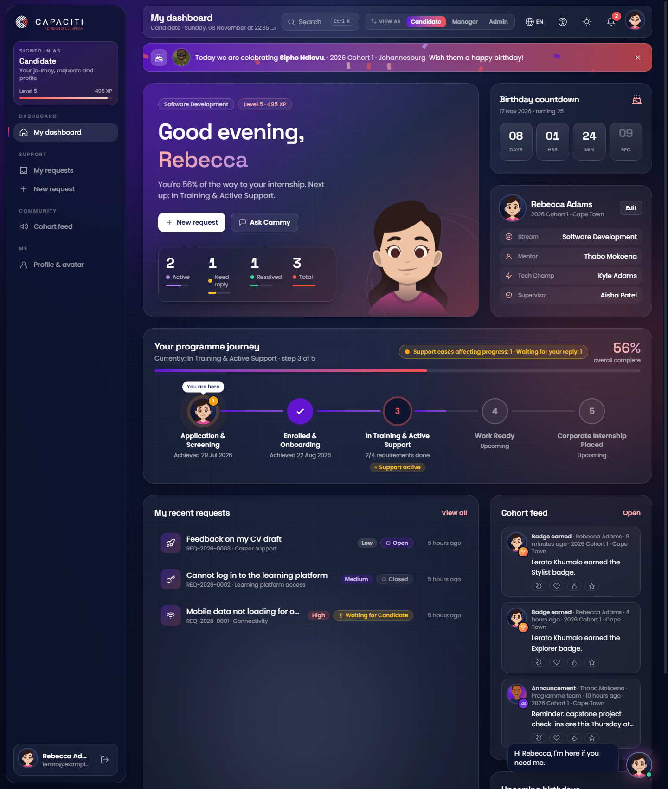

<p align="center"></p>

<h1 align="center">CAPACITI Candidate Support & Service Request System</h1>

<p align="center">A secure, accessible, multilingual support platform. It takes candidates' support requests from "I need help" to "resolved", with a workflow that is enforced by the database itself.</p>

<p align="center">
  <b>Live app:</b> <a href="https://YOUR-APP.onrender.com">https://YOUR-APP.onrender.com</a> ·
  <b>API:</b> <a href="https://YOUR-APP.onrender.com/api/health">/api</a> ·
  <b>Repository:</b> <a href="https://github.com/rebeccacamissa/CapacitiTicketSystem">GitHub</a>
</p>



## The problem

CAPACITI candidates raise support needs (connectivity, platform access, attendance, assessments, well-being, careers) through scattered channels. Requests get lost, nobody can see their status, and managers can't tell where the bottlenecks are. This system gives:

- **Candidates:** one place to ask for help, track every step live, and see their whole programme journey.
- **Support teams:** a prioritised queue, SLA tracking, workload balance and satisfaction scores.
- **Administrators:** full control of users, roles and categories, with an audit trail that can't be altered.

## Key features

| Area | Highlights |
|---|---|
| **Workflow engine** | Open → Assigned → In Progress ⇄ Waiting for Candidate → Resolved → Closed (→ Reopened). Every change runs in a **database transaction**, and **SQLite triggers** reject illegal jumps, missing assignees or resolutions, and any change without an audit record. Admin overrides are one-shot and audited. |
| **Requests** | Automatic `REQ-2026-0001` references, SLA due dates by priority, search, filters, sorting, pagination, attachments with real file-type checks, internal notes, and 1–5 star satisfaction ratings |
| **Candidate journey** | Animated 5-milestone roadmap (Screening → Onboarding → Training → Work Ready → Internship) with requirement tracking and alerts when open support cases may affect progress |
| **Dashboards** | Support dashboard (queue, workload, 14-day trend, category and priority breakdowns, overdue cases, satisfaction) and admin control centre |
| **Live** | Server-Sent Events: tickets, notifications, roadmaps and the feed update without a refresh |
| **Cammy** | An assistant that wears each user's avatar, has 7 moods, gives role-specific first-sign-in walkthroughs and answers from live data in 5 languages |
| **Avatars** | Avatar studio with two art styles (Polished and the inclusive Classic), four looks, and badge-unlocked items |
| **Engagement** | XP, levels, 12 badges, a cohort feed with reactions, and birthday celebrations |
| **Accessibility** | High contrast, 4 text sizes, dyslexia and low-vision fonts, spacing, colour-blind-safe colours, reading guide, read-aloud, voice input, easy-read mode, keyboard shortcuts, screen-reader announcements, and a private accessibility-needs profile |
| **Languages** | English, isiZulu, isiXhosa, Afrikaans, Sepedi (translations awaiting native-speaker review) |
| **Security** | bcrypt, httpOnly SameSite=Strict JWT cookie, role checks on the server, temporary-password enforcement, rate limiting, parameterised SQL, Helmet CSP, sandboxed downloads |

## Tech stack

| Layer | Technology |
|---|---|
| Frontend | HTML5, Tailwind CSS v4, vanilla JavaScript (ES modules, `fetch`), Server-Sent Events, Web Speech API |
| Backend | Node.js 22.13+ (tested on 24), Express 5, modular middleware (auth, validation, rate limiting, errors) |
| Database | SQLite via built-in `node:sqlite` (no native build), with foreign keys, CHECK constraints, triggers and explicit transactions |
| Security | `bcryptjs`, `jsonwebtoken`, `helmet`, `cookie-parser`, `dotenv` |
| Avatars | DiceBear (Avataaars by Pablo Stanley; toonHead by Johan Melin, CC BY 4.0) |
| Testing | Node's built-in test runner (21 end-to-end API tests on an in-memory database) |

## Quick start

```bash
git clone https://github.com/rebeccacamissa/CapacitiTicketSystem.git
cd CapacitiTicketSystem
npm install
cp .env.example .env        # set JWT_SECRET; DEMO_MODE=true enables one-click role sign-in
npm run db:reset            # create the schema and load demo data
npm start                   # builds the CSS, then serves http://localhost:3000
```

| Role | Email | Password |
|---|---|---|
| Candidate | `lerato@example.com` (also `sipho@`, `zanele@`, `kagiso@`, `amahle@` at `example.com`) | `Capaciti@2026` |
| Support / Manager | `thabo@capaciti.org.za`, `aisha@capaciti.org.za` | `Capaciti@2026` |
| Administrator | `admin@capaciti.org.za` | `Capaciti@2026` |

| Script | Purpose |
|---|---|
| `npm start` / `npm run dev` | Run the app (`dev` restarts automatically on changes) |
| `npm test` / `npm run test:report` | Run the API tests / write the full report |
| `npm run demo:illegal` | Show that SQLite blocks illegal transitions using raw SQL |
| `npm run db:reset` / `npm run db:seed` | Reset and reseed the database / seed only if empty |
| `npm run i18n` | Rebuild translation dictionaries from `i18n-source/` |
| `npm run build:css` / `npm run watch:css` | Build or watch the Tailwind CSS |
| `npm run start:prod` | Production start: seed if empty, then serve |

## Documentation

| Document | Contents |
|---|---|
| [API documentation](docs/API.md) | Every endpoint with access rules, request and response formats, and error codes |
| [Database design](docs/DATABASE.md) | ER diagram (Mermaid), table groups, constraints and the triggers behind the state machine |
| [User roles](docs/USER-ROLES.md) | Candidate, Support/Manager and Administrator: permission matrix and walk-throughs |
| [Testing evidence](docs/TESTING.md) | Automated test list and results, database enforcement demo, manual checks, bugs fixed |
| [Screenshots](docs/SCREENSHOTS.md) | 20 annotated screens across all roles, themes, languages and mobile |
| [Deployment and GitHub](docs/DEPLOYMENT.md) | Render blueprint, Docker, environment variables, repository setup, submission checklist |
| [Limitations and roadmap](docs/LIMITATIONS-AND-ROADMAP.md) | Known limitations and short-, medium- and long-term recommendations |

## Project structure

```
capaciti-support/
├── server/
│   ├── app.js, server.js           Express app (Helmet CSP, routing, static files) and bootstrap
│   ├── config/                     env, reference lists, accessibility needs
│   ├── db/                         schema.sql (tables, triggers, reference data), connection, seed
│   ├── middleware/                 auth (JWT + RBAC), validate, rateLimit, errorHandler
│   ├── realtime/                   Server-Sent Events hub
│   ├── i18n/                       generated server dictionaries (Cammy)
│   └── modules/
│       ├── auth/          [A]      register, login, temporary passwords, demo sign-in
│       ├── requests/      [B]      requests, reference generator, search, attachments, ratings
│       ├── workflow/      [C]      state machine rules, transaction pipeline, audit engine
│       ├── analytics/     [D]      dashboard metrics
│       ├── progress/      [D]      candidate roadmap
│       ├── admin/                  users, roles, categories
│       ├── people/                 profiles, birthdays, notifications, candidate records
│       ├── engage/                 XP, badges, feed, preferences, search
│       ├── avatar/                 avatar catalogue and DiceBear renderer
│       └── cammy/                  Cammy assistant
├── public/                         HTML pages, js/ (pages, components, i18n, a11y), assets/
├── src/tailwind.css                design tokens (CAPACITI palette), themes, accessibility CSS
├── i18n-source/                    translation source: one English line next to its 4 translations
├── tests/                          end-to-end API tests
├── scripts/                        DB enforcement demo, i18n build
├── docs/                           documentation, screenshots, test evidence
└── Dockerfile, render.yaml         deployment
```

`[A]` to `[D]` are the group members' areas of ownership: Auth and Roles; Candidate Module and Search; State Machine and Audit; Dashboards and Analytics.

## Credits and licences

- **Brand:** CAPACITI logo and Colour Palette 4 belong to CAPACITI (UVU Africa).
- **Avatar art:**
  - [Avataaars](https://avataaars.com) by Pablo Stanley (free for personal and commercial use);
  - [toonHead](https://www.figma.com/community/file/1589627891082866389) by Johan Melin ([CC BY 4.0](https://creativecommons.org/licenses/by/4.0/));
  - both rendered with [DiceBear](https://www.dicebear.com).
- **Fonts:** Poppins, Space Grotesk, Lexend and Atkinson Hyperlegible (Google Fonts, SIL Open Font License).
