# Database design

- **Engine:** SQLite 3.50, using Node's built-in `node:sqlite`, with WAL journal mode and foreign keys enforced.
- **Schema:** [`server/db/schema.sql`](../server/db/schema.sql). It is applied automatically and idempotently on start-up.

## Entity-relationship diagram

```mermaid
erDiagram
    users ||--o| candidate_profiles : "has (candidates)"
    users ||--o| staff_profiles : "has (staff)"
    users ||--o{ requests : "raises (candidate_id)"
    users ||--o{ requests : "is assigned (assigned_to)"
    categories ||--o{ requests : classifies
    request_statuses ||--o{ requests : "current status"
    request_statuses ||--o{ status_transitions : "from / to"
    priority_sla ||--o{ requests : "sets SLA"
    requests ||--o{ request_messages : has
    requests ||--o{ audit_log : "history of"
    requests ||--o| transition_overrides : "one-shot admin token"
    requests ||--o{ attachments : has
    requests ||--o| request_ratings : "rated by candidate"
    users ||--o{ request_messages : writes
    users ||--o{ audit_log : "changed_by"
    milestones ||--o{ milestone_requirements : contains
    milestone_requirements ||--o{ candidate_requirement_progress : "completed in"
    users ||--o{ candidate_requirement_progress : "progress of"
    programme_stages ||--o{ candidate_stages : "current stage"
    users ||--o| candidate_stages : "official stage of"
    users ||--o{ stage_decisions : "decided for / decided by"
    programme_stages ||--o{ stage_decisions : "from / to"
    users ||--o{ facilitator_streams : "facilitates"
    users ||--o| candidate_portfolios : publishes
    users ||--o{ portfolio_items : "project links"
    users ||--o{ portfolio_files : "CV / project / certificate"
    users ||--o{ recruiter_shortlist : "shortlists (recruiter / candidate)"
    users ||--o{ xp_events : earns
    users ||--o{ user_badges : holds
    users ||--o{ feed_posts : "author / subject"
    feed_posts ||--o{ feed_reactions : receives

    users {
        INTEGER id PK
        TEXT full_name
        TEXT first_name
        TEXT surname
        TEXT email UK "COLLATE NOCASE"
        TEXT password_hash "bcrypt"
        TEXT role "candidate | support | admin"
        INTEGER is_active
        TEXT date_of_birth "YYYY-MM-DD"
        TEXT gender
        TEXT avatar_config "JSON design"
        TEXT preferences "JSON theme/a11y"
        TEXT accessibility "JSON needs (private)"
        TEXT language "en zu xh af nso"
        INTEGER tour_done
        INTEGER must_change_password
        TEXT created_at
    }
    candidate_profiles {
        INTEGER user_id PK,FK
        TEXT cohort
        TEXT stream
        TEXT mentor
        TEXT tech_champ
        TEXT supervisor
        INTEGER updated_by FK
    }
    staff_profiles {
        INTEGER user_id PK,FK
        TEXT position
        TEXT employee_id UK
    }
    categories {
        INTEGER id PK
        TEXT name UK
        TEXT description
        INTEGER is_blocker "affects roadmap"
        INTEGER is_active
    }
    request_statuses {
        TEXT name PK
        INTEGER sort_order
        INTEGER is_terminal
    }
    status_transitions {
        TEXT from_status PK,FK
        TEXT to_status PK,FK
    }
    priority_sla {
        TEXT priority PK
        INTEGER hours
        INTEGER rank
    }
    reference_counters {
        INTEGER year PK
        INTEGER last_value
    }
    requests {
        INTEGER id PK
        TEXT reference UK "REQ-YYYY-NNNN"
        INTEGER candidate_id FK
        INTEGER category_id FK
        TEXT title
        TEXT description
        TEXT priority FK
        TEXT status FK
        INTEGER assigned_to FK
        TEXT resolution
        TEXT due_at
        TEXT created_at
        TEXT updated_at
        TEXT resolved_at
        TEXT closed_at
    }
    request_messages {
        INTEGER id PK
        INTEGER request_id FK
        INTEGER author_id FK
        TEXT body
        INTEGER is_internal
        TEXT created_at
    }
    audit_log {
        INTEGER id PK
        INTEGER request_id FK
        INTEGER changed_by_user_id FK
        TEXT action "CREATED STATUS_CHANGE ASSIGNMENT PRIORITY_CHANGE"
        TEXT old_status
        TEXT new_status
        TEXT details
        TEXT internal_notes
        INTEGER is_override
        TEXT timestamp
    }
    transition_overrides {
        INTEGER request_id PK,FK
        TEXT to_status
        INTEGER authorized_by FK
    }
    attachments {
        INTEGER id PK
        INTEGER request_id FK
        INTEGER uploader_id FK
        TEXT stored_name UK
        TEXT original_name
        TEXT mime
        INTEGER size
        INTEGER is_internal
    }
    request_ratings {
        INTEGER request_id PK,FK
        INTEGER candidate_id FK
        INTEGER rating "1-5"
        TEXT comment
    }
    milestones {
        INTEGER id PK
        TEXT key UK
        TEXT title
        INTEGER sort_order
    }
    milestone_requirements {
        INTEGER id PK
        INTEGER milestone_id FK
        TEXT label
        INTEGER sort_order
    }
    candidate_requirement_progress {
        INTEGER candidate_id PK,FK
        INTEGER requirement_id PK,FK
        TEXT completed_at
        INTEGER verified_by FK
    }
    xp_events {
        INTEGER id PK
        INTEGER user_id FK
        TEXT kind
        TEXT ref
        INTEGER points
    }
    user_badges {
        INTEGER user_id PK,FK
        TEXT badge_key PK
        TEXT awarded_at
    }
    feed_posts {
        INTEGER id PK
        TEXT kind
        INTEGER author_id FK
        INTEGER subject_id FK
        TEXT cohort
        TEXT body
        TEXT ref UK
    }
    feed_reactions {
        INTEGER post_id PK,FK
        INTEGER user_id PK,FK
        TEXT reaction PK
    }
    programme_stages {
        TEXT key PK
        TEXT label
        INTEGER sort_order UK
    }
    candidate_stages {
        INTEGER candidate_id PK,FK
        TEXT stage FK
        TEXT updated_at
    }
    stage_decisions {
        INTEGER id PK
        INTEGER candidate_id FK
        TEXT from_stage FK
        TEXT to_stage FK
        TEXT direction "initial | forward | backward"
        INTEGER decided_by FK
        TEXT reason
        TEXT created_at
    }
    facilitator_streams {
        INTEGER user_id PK,FK
        TEXT stream PK
    }
    portfolio_files {
        INTEGER id PK
        INTEGER candidate_id FK
        TEXT kind "cv | project | certificate"
        TEXT title
        TEXT stored_name UK
        TEXT mime
        INTEGER size
        TEXT source "upload | ai_tailored"
    }
    recruiter_shortlist {
        INTEGER recruiter_id PK,FK
        INTEGER candidate_id PK,FK
        TEXT note
    }
```

> GitHub renders this Mermaid diagram automatically. To export a PNG, paste it into [mermaid.live](https://mermaid.live).

## Table groups

| Group | Tables | Purpose |
|---|---|---|
| Identity | `users`, `candidate_profiles`, `staff_profiles` | Accounts, role-specific details, preferences, accessibility needs, language |
| Ticketing core | `requests`, `request_messages`, `attachments`, `request_ratings`, `categories`, `priority_sla`, `reference_counters` | Requests, conversations, files, satisfaction ratings, SLA and reference numbers |
| Workflow engine | `request_statuses`, `status_transitions`, `transition_overrides`, `audit_log` | The state machine whitelist, admin override tokens, and the immutable history |
| Candidate journey | `milestones`, `milestone_requirements`, `candidate_requirement_progress` | One roadmap node per stage, and its exit criteria (supporting evidence) |
| Official stages | `programme_stages`, `candidate_stages`, `stage_decisions`, `facilitator_streams` | The 5 official stages, each candidate's current stage (no row = Enrolled), the append-only stage audit trail, and which streams each facilitator approves |
| Portfolio & recruiting | `candidate_portfolios`, `portfolio_items`, `portfolio_files`, `recruiter_shortlist` | Published profile, project links, uploaded CV/project/certificate files, each recruiter's private shortlist |
| Engagement | `xp_events`, `user_badges`, `feed_posts`, `feed_reactions` | XP, badges, the cohort feed and reactions |

## Integrity rules enforced by the database

**Constraints**
- `CHECK` constraints on roles, priorities, flags and lengths, the reference format (`REQ-YYYY-N…`), date of birth, `json_valid()` on JSON columns, ratings from 1 to 5, and attachment size of 5 MB or less.
- Foreign keys everywhere. A user's profile rows are removed when the user is (`ON DELETE CASCADE`).

**Triggers (the state machine)**

| Trigger | Rule |
|---|---|
| `trg_requests_insert_open` | New requests must start as `Open`. |
| `trg_requests_status_guard` (BEFORE UPDATE OF status) | The move must be in `status_transitions`, **or** a valid admin token must exist in `transition_overrides`. |
| | `Assigned`, `In Progress` and `Waiting for Candidate` need an assignee. |
| | `Resolved` needs a resolution. |
| | The **latest `audit_log` row must describe exactly this move**, so no status change can happen without an audit record. |
| `trg_requests_assignee_staff` | The assignee must be active support or admin staff. |
| `trg_requests_consume_override` | The override token is deleted after use, so it works only once. |
| `trg_audit_no_update`, `trg_audit_no_delete` | The audit log is append-only. |

**Triggers (official stages)**

| Trigger | Rule |
|---|---|
| `trg_stage_decision_guard` (BEFORE INSERT on `stage_decisions`) | `STAGE_UNCHANGED`: can't decide the stage the candidate is already at. |
| | `STAGE_STALE`: the decision must start from the candidate's current stage. |
| | `STAGE_SKIP`: forward decisions move exactly one stage. |
| | `STAGE_BACKWARD_ADMIN_ONLY`: only an active admin can move a candidate back. |
| | `STAGE_NOT_AUTHORISED`: forward decisions need an active admin or a facilitator assigned to the candidate's stream. |
| `trg_candidate_stage_insert`, `trg_candidate_stage_guard` | `STAGE_AUDIT_REQUIRED`: the official stage can only change to what the **latest stage decision** says, so there is no stage change without a who/when/why record. |
| `trg_stage_decisions_no_update`, `trg_stage_decisions_no_delete` | The stage audit trail is append-only. |

The reason is required by a `CHECK` (3–1000 characters); the API additionally requires 10+ characters for backward moves.

**Migration of older databases.** On start-up, a database with the old five milestones (screening, onboarding, training, work_ready, placed) is re-keyed in place: screening + onboarding become *Enrolled*, partner matching and the agreement move to *Work Ready*'s exit criteria, and *Completed* is added. Verified progress is kept. Each existing candidate then gets an official stage from their evidence, recorded as a system `initial` decision ("Imported from verified requirement progress") so the trail explains it. The `users` table is rebuilt once to allow the `facilitator` role.

**Idempotency**
- `UNIQUE (user_id, kind, ref)` on `xp_events` means XP can never be awarded twice for the same thing.
- `UNIQUE ref` on `feed_posts` means birthday and badge posts are created only once.

You can see the triggers working with `npm run demo:illegal`; the output is in [db-enforcement-demo.txt](db-enforcement-demo.txt).

## Seed and reference data

The schema itself inserts:
- the 7 statuses and 11 allowed transitions;
- SLA hours per priority: Urgent 4, High 24, Medium 72, Low 120;
- 11 categories, 5 of them blockers;
- 5 official stages, and 5 roadmap milestones with 20 exit criteria (Enrolled 8, In Training 4, Work Ready 5, Placed 3, Completed none).

`npm run db:reset` then loads demo users (including a facilitator for three streams and a recruiter), requests, evidence, stage decisions (inserted through the same triggers), ratings and feed posts. It drives every request through the real workflow code, so the audit trail is genuine.
